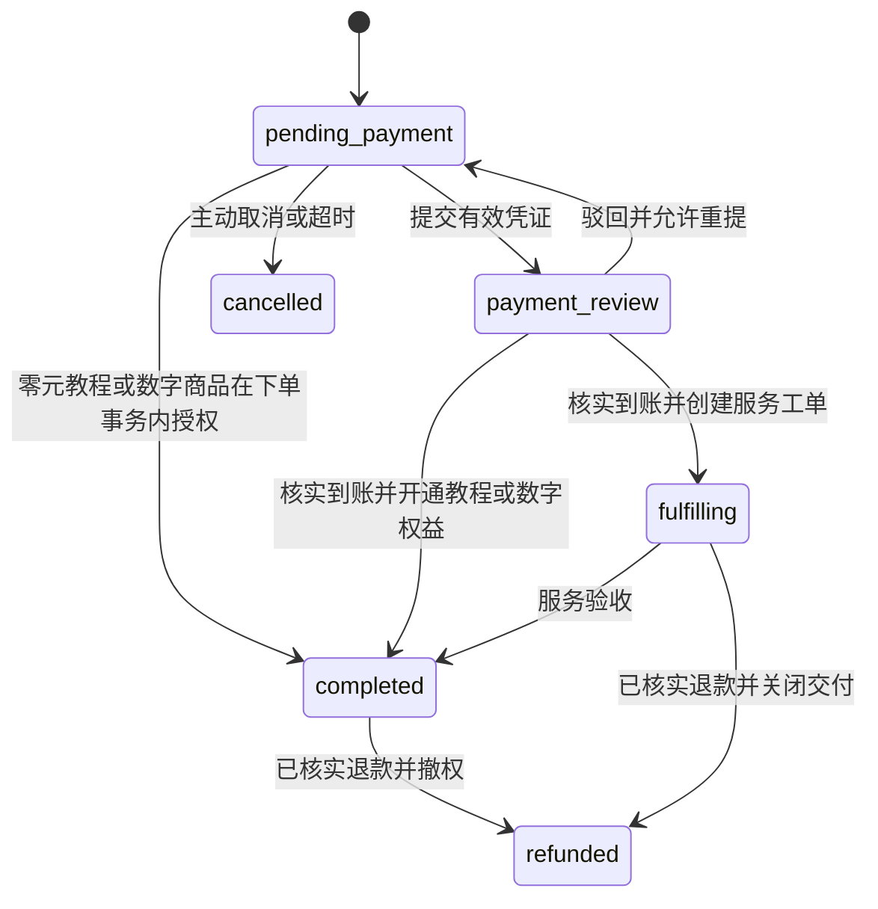

# DevStore V1.0 需求基线与首个交易闭环设计

日期：2026-10-09

状态：用户已选择 A（脚手架 + 教程交易闭环）；实施计划待审阅

来源：用户提供的《Rust + Vue 个人技术商业网站完整开发方案 V1.0 · MVP》

## 1. 目标与现状

建设个人技术品牌、数字商品商城、技术服务交易和知识教程平台。首版采用人工收款、人工核实到账，并将审核结果与内容权限、服务交付和操作审计关联。

用户已明确以下约束：

- Rust Axum + Tokio + SQLx + PostgreSQL，采用模块化单体。
- Nuxt 4 提供前台 SSR，Vue 3 + Vite 提供独立管理后台。
- Redis 负责辅助限流等能力，S3 兼容对象存储保存私有文件。
- 人民币金额统一使用整数分，订单保存商品快照。
- 单件商品下单；购物车、自动支付、会员订阅不进入 V1.0。
- 付费内容鉴权、文件权限和管理员权限均在后端执行。
- 深色科技风，兼顾移动端、可访问性和加载性能。

当前仓库只有 Git 初始化目录，没有业务文件、既有提交或项目级 AGENTS.md。已检测到 Rust、Cargo、Node、npm、Corepack、Docker 和 Docker Compose 的命令；尚未验证 Docker 引擎、依赖下载和服务启动。

## 2. 实施范围的三个选择

| 选择 | 本轮结果 | 取舍 |
| --- | --- | --- |
| A：脚手架 + 教程交易闭环（建议） | 一条可验证的注册、下单、提交凭证、人工审核、付费阅读链路 | 符合原方案的开发顺序，可尽早验证交易和权限设计；仍需后续实现数字下载、服务工单等模块 |
| B：完整 V1.0 | 覆盖原方案全部前台、后台、交付与运营验收项 | 需要拆成多个依赖明确的里程碑，不能用页面占位或内存模拟宣称完成 |
| C：方案整理与审查 | 清晰的需求、设计决策、风险边界及验收标准 | 本轮不进入业务代码实现 |

用户于 2026-10-09 选择 A。本文保留完整 V1.0 边界，并具体设计选择 A 的首个交付单元。后续模块属于已记录需求，不代表已经实现或验收。

## 3. 架构与模块边界

```text
Browser
  └─ Nginx：同源入口
       ├─ /          → Nuxt SSR
       ├─ /admin/    → Vue Admin 静态资源
       └─ /api/v1/   → Axum
                         ├─ PostgreSQL：事务与业务事实
                         ├─ Redis：共享限流计数
                         └─ 私有对象存储：付款凭证、商品文件
```

开发环境也使用同源入口，减少生产与本地 Cookie、CSRF、路由前缀的差异。管理后台保留独立构建和部署能力。

| 模块 | 职责 | 首个交付单元 |
| --- | --- | --- |
| auth / users | 注册、登录、会话、用户状态、管理员角色 | 实现注册、登录、刷新、退出、当前用户 |
| catalog | 分类、商品、发布状态、价格 | 实现商品浏览和后台商品管理 |
| orders | 商品快照、幂等下单、取消、超时 | 实现单件订单 |
| payments | 收款说明、凭证、核实与驳回 | 实现人工审核 |
| entitlements | 独立权益记录、授予和撤销 | 实现教程权益 |
| tutorials | 教程目录、预览、章节内容 | 实现图文教程和付费阅读 |
| admin | 汇总后台路由、审核与审计查询 | 实现交易链路需要的管理页面 |
| storage | 对象写入、访问权限、生命周期 | 实现私有付款凭证 |
| tickets / content | 服务工单、博客、站点内容 | 完整 V1.0 的后续交付单元 |

业务模块内部按需要拆分 handler、service、repository、model 和 dto。事务由业务服务控制；跨模块交付使用同一 PostgreSQL 事务，避免出现订单已收款但权限未开通的部分成功。

选择 A 时只允许发布和购买 tutorial 类型商品；digital 和 service 的数据类型预留，但在对应交付模块完成前，后端拒绝发布及创建这两类订单。不能收款后才发现交付能力尚未实现。

## 4. 首个交付单元的可见行为

### 前台

- 首页介绍品牌，展示已发布教程商品；商城支持必要的分类和搜索。
- 商品详情展示标题、内容范围、价格、预览与购买入口。
- 用户注册并登录后下单；未登录用户完成登录后返回购买流程。
- 收银台显示服务端金额、订单编号、有效时间和已配置的收款说明。
- 用户上传凭证后显示待审核；被驳回时展示原因并允许重新提交。
- 用户中心展示订单详情、审核记录和已购教程入口。
- 教程目录可公开访问；预览章节公开，付费正文仅在后端授权后返回。

### 管理后台

- 管理员可创建、修改、发布和下架商品，编辑教程和章节。
- 待审核列表展示订单、金额、提交时间及受保护的凭证预览。
- 通过审核时必须填写实际到账金额、收款渠道和渠道交易流水号，并显式确认已核实实际到账。
- 驳回必须填写原因。操作成功后刷新状态；重复提交不重复授权。
- 审计页面展示操作者、动作、目标、时间和结果摘要。

不提供可用于正式交易的默认收款账户或默认管理员密码。未配置收款方式时拒绝创建付费订单，并返回明确的业务错误，避免用户得到无法付款的订单。

## 5. 认证、会话与跨站请求防护

- 邮箱在注册和登录时按一致规则规范化；数据库保证规范化邮箱唯一。
- 密码使用 Argon2id 哈希，不出现在响应或日志中。
- 短期 Access Token 和可撤销的随机 Refresh Token 使用 HttpOnly Cookie；数据库只保存 Refresh Token 哈希。
- Refresh Token 轮换以数据库事务保证原子性；同一会话的旧令牌不能再次刷新。
- Access Token 关联会话 ID。受保护请求检查用户及会话状态，使退出、禁用用户和撤销会话立即生效。
- 生产 Cookie 设置 Secure、HttpOnly 和 SameSite；开发环境的非 Secure 设置不得用于生产。
- 变更请求验证精确 Origin，并校验与会话绑定的 CSRF Token；登录、注册等建立会话的请求也检查来源。
- Nuxt 仅向配置的内部 API 转发当前请求的认证 Cookie；不把 Cookie 转发给第三方，不把令牌序列化进 SSR 页面。
- 管理员角色、用户状态和资源归属必须在后端检查，不信任客户端传入的 user_id、角色或金额。
- 注册、登录、刷新和上传设置共享限流。只信任已配置反向代理提供的客户端地址。

首个交付单元的管理员通过显式运维命令初始化；公网生产上线前必须补齐管理员额外身份验证和密码重置流程，这两项属于完整 V1.0 的上线门槛。

## 6. 数据库约束与迁移

以原方案的数据表为基线，首个交付单元创建 users、user_sessions、roles、user_roles、categories、products、tutorials、tutorial_chapters、orders、order_items、payment_submissions、user_entitlements、admin_audit_logs 和 site_settings；另增加以下两张支撑表：

- `order_requests`：user_id、idempotency_key、request_fingerprint、order_id。唯一约束 `(user_id, idempotency_key)`，用于绑定请求载荷及结果。
- `file_objects`：id、owner_id、purpose、storage_key、content_type、size_bytes、sha256、status。凭证引用文件 ID，由后端解析存储 Key，不接受任意客户端对象路径。

需要在迁移中落实的约束：

1. 所有外键、CHECK 约束和常用查询索引必须随迁移提交；首个闭环不能依赖人工建表。
2. `currency = 'CNY'`；金额非负且在服务端业务上限内，计算使用检查溢出的整数运算。
3. V1.0 的 `quantity = 1`；首个实现通过 `UNIQUE(order_id)` 限制一张订单一个明细。未来多商品订单通过新迁移放宽。
4. `subtotal_cents = unit_price_cents * quantity`，创建订单与明细在同一事务中提交。
5. 订单请求的幂等键按用户隔离；同一键不同商品或数量返回 409，同一载荷返回原订单。
6. 每张订单最多一个待审核凭证，以及最多一个已通过凭证，分别使用条件唯一索引。
7. `user_entitlements.order_item_id` 唯一；服务模块增加 `service_tickets.order_item_id` 唯一，防止重复交付。
8. 审核通过记录保存管理员、审核时间、实际金额、渠道和交易流水号；渠道与已通过流水号的组合唯一，防止同笔转账为不同订单重复核销。
9. 被审核的凭证不能再次变更状态；撤回或修正走明确的退款或补偿流程。
10. 交易历史不物理删除。商品下架只影响新购买；已有权益继续可用，退款或明确撤权后才失效。

商品名称、类型、金额和币种都在下单时保存快照。后台修改商品不回写历史订单。通用更新时间由统一机制维护，不能依赖每个 handler 自觉更新。

## 7. 订单状态机与并发语义



`paid` 表示已核实到账的业务事实。对于同库内可完成的教程授权，设置 paid_at、记录审核和授予权益在一个事务中完成，提交时最终状态为 completed，不为展示过程刻意拆开事务。未来存在外部异步交付时再使用可观测的 paid 中间状态和可靠任务记录。

### 锁定顺序

提交凭证、审核、取消、超时关闭、退款始终先锁定订单，再访问凭证、权益或工单。审核可先读取凭证对应的 order_id，但必须在获得订单锁后重新锁定并验证凭证，避免只检查锁定前的旧状态。

### 下单

1. 在事务中占用用户范围的幂等键，校验请求指纹；并发重复请求等待后读取既有结果。
2. 查询并锁定商品，重新检查发布状态、类型、币种、价格和收款配置。
3. 创建订单与商品快照，并绑定幂等记录；成功后一次提交。
4. 零元商品走独立的免费领取分支并幂等授权，不要求上传付款凭证。

### 提交、驳回与超时

- 仅订单所有者可提交凭证；文件必须属于本人且 purpose 正确，已完成类型检查和安全扫描。
- 仅有效期内的 pending_payment 订单可进入 payment_review。
- payment_review 不允许用户取消，也不被自动超时任务取消。待审核超时进入人工排查列表。
- 驳回回到 pending_payment，保留审核历史，并将重提窗口延长至至少审核后 24 小时。
- 超时任务只关闭 pending_payment，使用与审核一致的行锁规则。
- 已取消但用户声称已转账的情况进入人工核对，不自动恢复订单，也不丢弃到账线索。

### 审核通过

1. 验证管理员权限并锁定订单、凭证。
2. 已通过时返回当前结果，不改变既有审核内容，不追加重复交付；已驳回凭证不能被批准。
3. 校验订单为 payment_review，实际到账金额等于订单金额，交易流水未被其他审核核销。
4. 更新凭证和订单，插入权益或工单，写入管理员审计，全部使用同一事务。
5. 任何一步失败则全部回滚。事务外通知失败不能推翻已提交的收款事实。

首个交付单元使用页面轮询查询状态；邮件通知属于后续版本，当前不引入消息队列。

### 退款与撤权

完整 V1.0 必须包含“人工完成退款后登记”的后台动作。它不发起自动转账。登记时核对退款金额与原审核记录、保存退款参考号，并在订单锁内更新订单、撤销权益、终止未完成的工单访问及记录审计。首版限定整单退款，不支持部分退款。

短期签名下载地址签发后通常在到期前仍可使用。若选择直连对象存储，退款撤权对已签发地址的剩余有效时间必须明确；若要求即时撤销，则通过后端代理逐次验证权限。不能将“短时到期”描述成“立即撤销”。

## 8. 私有文件与付费内容

- 付款凭证首版仅接收 JPEG、PNG，限制为 5 MiB；验证文件签名、可解码性及像素上限，不信任扩展名或浏览器 MIME。
- 上传先进入隔离区，安全扫描失败或扫描服务不可用时不进入可审核状态。生产环境不得默默跳过扫描。
- 凭证和商品文件使用不同对象前缀与用途标记；桶禁止公开读取及目录列举。
- 后台凭证预览通过受鉴权的 API，校验管理员角色、文件用途和订单关联；响应禁止共享缓存，并设置正确 MIME 和 nosniff。
- 用户只能访问自己提交的凭证；商品下载接口只能接受有有效权益的商品文件 ID，禁止通用任意 Key 签名接口。
- 清理孤立上传时只删除超过保留窗口且没有凭证关联的对象，不与进行中的上传或审核竞争。
- 章节目录只返回元数据；受保护正文不包含在公共接口、搜索结果、SSR 初始数据或静态构建资源中。
- Markdown 禁止原始 HTML，链接协议白名单过滤；代码高亮输出仍经过安全渲染策略，不直接 v-html 注入不可信 HTML。
- 用户数据、收银台、付费阅读和后台响应使用 private/no-store，禁止 CDN 或服务端共享缓存跨用户复用。

完整 V1.0 的数字商品下载签名地址默认有效期 60 秒，签发前检查当前权益并写下载日志；地址、凭证内容和认证令牌不得出现在常规访问日志中。

## 9. API 约定

统一前缀 `/api/v1`，统一响应包含 code、message、data 和 request_id。request_id 由入口生成或校验后传递，错误响应和 tracing 日志使用同一标识。

- 创建接口成功使用 201；其他成功接口使用与行为匹配的状态码。
- 参数、JSON、路径、查询和 multipart 提取错误也进入统一错误响应。
- 未登录 401，缺少角色权限 403；他人订单、文件、工单按不存在处理为 404。
- 状态冲突、重复键载荷冲突为 409；合法 JSON 中的业务参数校验错误为 422。
- 数据库内部错误、存储凭证、堆栈不返回给客户端。
- 列表限制最大页大小，固定排序并带唯一字段打破同时间排序歧义。
- 浏览器使用 Cookie 认证，因此原方案的 Bearer 示例不作为浏览器令牌存储方案。
- 首个交付单元的上传采用后端 multipart；响应返回文件/凭证 ID，不公开对象 Key。

首个闭环所需 API：

| 分组 | 接口 |
| --- | --- |
| 认证 | POST /auth/register、/auth/login、/auth/refresh、/auth/logout；GET /auth/csrf、/users/me |
| 商品 | GET /categories、/products、/products/{slug} |
| 教程 | GET /tutorials、/tutorials/{slug}、/tutorials/{id}/chapters/{chapterId} |
| 订单 | POST /orders；GET /orders、/orders/{id}；POST /orders/{id}/cancel |
| 付款 | GET /orders/{id}/payment-instructions；POST /orders/{id}/payment-proof |
| 权益 | GET /me/library |
| 后台商品 | GET /admin/products；POST /admin/products；PATCH /admin/products/{id} |
| 后台教程 | POST /admin/tutorials；PATCH /admin/tutorials/{id}；POST /admin/tutorials/{id}/chapters；PATCH /admin/tutorials/{id}/chapters/{chapterId} |
| 后台交易 | GET /admin/orders、/admin/payments；GET /admin/payments/{id}/proof；POST /admin/payments/{id}/approve、/admin/payments/{id}/reject |
| 后台审计 | GET /admin/audit-logs |

审批请求包含 actual_amount_cents、payment_channel、transaction_reference、receipt_confirmed 和 review_note；receipt_confirmed 必须为 true，但勾选本身不能替代管理员检查真实收款记录。

## 10. 界面与路由

沿用原方案 Token：背景 #0B1020，卡片 #172033，主色 #6366F1，强调色 #22D3EE，文字 #F8FAFC，次级文字 #94A3B8，边框 #293449，圆角 12–16px。

首个交付单元实现 `/`、`/products`、`/products/[slug]`、`/tutorials`、`/tutorials/[slug]`、`/login`、`/register`、`/checkout/[id]`、`/user/orders`、`/user/library`，及对应后台登录、商品、教程、订单、审核、审计页面。

每个异步页面必须有加载、空数据、请求失败和成功反馈。交互具备键盘焦点、表单标签与可读错误；关键状态同时使用文字，不能仅靠颜色区分。移动端导航、长订单号、代码块和审核列表需要单独验证。

没有实现的完整 V1.0 路由不展示成可操作入口。示例商品和收款配置明确区分，禁止使用虚构销量、评价和成交额作为真实经营数据。

## 11. 部署与运行

项目目录沿用 `apps/web`、`apps/admin`、`server`、`packages`、`deploy` 和 `docs`。依赖版本在实现时核实并锁定，不在设计文档中把浮动 latest 当作可复现配置。

- 本地目标：复制环境变量模板、配置必要值后，通过一条 Docker Compose 命令启动入口、前台、后台、API、数据库、Redis、对象存储及扫描组件。
- 仅入口对外发布端口；PostgreSQL、Redis 和私有存储走内部网络。
- API 区分存活和就绪探针；数据库不可用时不能报告就绪。
- 数据库迁移失败阻止 API 就绪；避免多个实例无协调并发迁移。
- 配置启动时校验，生产缺失密钥、收款配置或安全组件时明确失败。
- `.env.example` 只包含占位说明；密钥、真实凭证、数据库转储和用户上传不提交 Git。
- 正式部署需要域名、服务器、真实收款方式、管理员信息和存储凭据；本地开发可先完成，不应虚构这些值或宣称已经上线。
- 完整 V1.0 补齐 HTTPS、备份、异地备份与恢复演练、监控告警、隐私和服务条款的发布配置。

## 12. 验收与验证设计

### 首个交付单元

1. 空数据库迁移及显式管理员初始化成功；按 README 可启动服务并通过健康检查。
2. 注册、登录、刷新、退出正常，密码不明文保存；退出后旧会话不可继续访问受保护 API。
3. 管理员发布教程商品，普通用户无法调用后台接口；商品下架后拒绝新订单但保留原购买者访问权。
4. 客户端伪造价格不影响订单，快照在商品改价后保持不变。
5. 相同幂等键并发下单只有一个订单；不同用户互不冲突；相同键不同载荷返回 409。
6. 未购买用户可读预览且无法从 API、SSR 或缓存获取付费正文。
7. 凭证上传验证类型、大小、所有权和扫描状态；待审核时禁止重复提交。
8. 驳回后可以看到原因并重提；旧凭证不能再次审批。
9. 并发审核、超时重试、审批后刷新均不重复产生权益、核销记录和审核审计。
10. 审核过程注入数据库错误后订单、凭证、权益、审计全部回滚。
11. 不同订单不能核销同一渠道的同一交易流水；金额不符不能通过。
12. 取消/超时与审核竞争时只产生合法结果，待审核订单不被自动取消。
13. 用户不能访问他人的订单或凭证；用户与管理员私有响应不被共享缓存。
14. PC 和移动端真实走通“浏览 → 注册 → 下单 → 凭证 → 驳回 → 重提 → 核实通过 → 付费阅读”。

业务状态机使用单元测试；事务、唯一约束和并发竞争使用真实 PostgreSQL 集成测试；文件权限与扫描失败覆盖集成测试；关键购买链路使用浏览器端到端测试。构建成功或 mock 测试不替代这些验证。

### 完整 V1.0 的剩余门槛

- 密码重置、管理员额外身份验证、用户资料和禁用管理。
- 数字资源私有交付、短时下载签名及下载记录。
- 服务工单、消息、附件、受理和交付验收。
- 退款登记、权益撤销、服务终止和相应并发测试。
- 博客、关于、站点设置、后台看板和内容管理。
- HTTPS、备份恢复、生产监控和部署验收。

原方案的 6 周是目标排期，实际进度以验证通过的交付单元计，不把静态页面数或文档完成度折算成上线完成度。

## 13. 本轮输出状态

- 已完成：空仓库检查、用户方案去重归纳、首个闭环设计、关键业务规则补充。
- 已确认：本轮采用 A（脚手架 + 教程交易闭环）。
- 待审阅：对应的实施计划和执行方式。
- 尚未执行：项目脚手架、安装依赖、数据库迁移、业务代码、运行测试、部署。

本文件是可审阅的设计稿，不是已实现功能清单。
